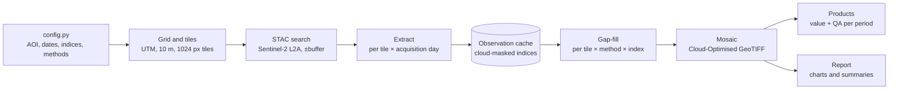
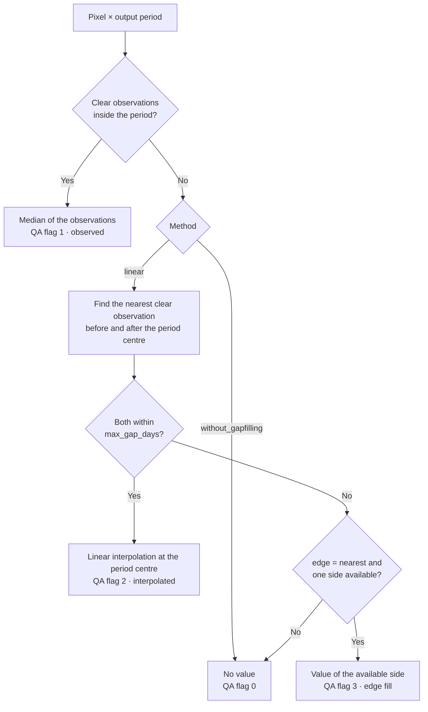

# Sentinel2 Gap Filling

A tiled, resumable pipeline that produces cloud-free Sentinel-2 spectral index time series on a regular temporal grid.

The pipeline:
- retrieves Sentinel-2 Level-2A surface reflectance from a public STAC catalogue;
- masks clouds and shadows;
- derives a configurable set of spectral indices;
- reconstructs missing observations with interchangeable gap-filling methods.

Outputs are Cloud-Optimised GeoTIFFs with a per-pixel quality layer, one per index and time period, for any area of interest.

## Features

- **Regular time series**: 10-day (dekadal) or fixed N-day periods, at 10 m resolution.
- **Spectral indices**: NDVI, NDWI, NDMI, EVI, and SWIR1/SWIR2 surface reflectance. New indices are a single definition in `src/indices.py`.
- **Pluggable gap-filling methods**: methods run side by side on identical inputs, so results are directly comparable.
- **Per-pixel quality assurance**: every output value is flagged as observed, interpolated or missing. Interpolated values also record the length of the gap they bridge.
- **Scalable processing**: the area is split into tiles, processed in parallel, and written atomically. Memory use depends on tile size, not on the size of the area.
- **Incremental execution**: imagery is downloaded once and cached. Each stage skips completed work, so interrupted runs resume where they stopped.
- **Open data and software**: Sentinel-2 Collection-1 COGs via [Earth Search](https://earth-search.aws.element84.com/v1), processed with GDAL, rasterio and NumPy.

## Installation

```bash
conda env create -f environment.yml   # creates the "gdal" environment
conda activate gdal
```

## Usage

1. Place the area-of-interest boundary in `data/`, as a GeoJSON or any format GeoPandas can read.
2. Edit `config.py`: AOI, date range, period, indices, methods and worker counts.
3. Run the pipeline:

```bash
python run_pipeline.py
```

The output projection is the UTM zone of the AOI centroid, unless `OUTPUT_CRS` is set. Set `OVERWRITE = True` to recompute everything.

### Main settings (`config.py`)

| Setting | Description | Default |
|---|---|---|
| `AOI_GEOJSON` / `EXTENT` | Area of interest: a boundary file or a lon/lat bounding box | `data/features.geojson` |
| `START`, `END` | Output date range (inclusive) | `2025-05-01` – `2025-10-31` |
| `BUFFER_DAYS` | Extra imagery read on both sides of the range, so the first and last periods can be interpolated | `45` |
| `PERIOD` | `"dekad"` (1–10, 11–20, 21–end of month) or a fixed number of days | `"dekad"` |
| `RESOLUTION_M` | Output pixel size in metres | `10` |
| `INDICES` | Indices to produce | all six |
| `METHODS` | Gap-filling methods and their parameters | `without_gapfilling`, `linear` |
| `TILE_SIZE_PX` | Tile edge length in pixels; controls memory per worker | `1024` |
| `IO_WORKERS`, `CPU_WORKERS` | Parallel downloads (threads) and parallel tiles (processes) | `8`, `4` |
| `OUTPUT_DTYPE` | `float32`, or `int16` scaled by 10 000 | `float32` |

## Workflow



| Stage | Description |
|---|---|
| **1. Extract** | For each tile and acquisition (solar) day, the relevant scenes are read directly from cloud-hosted COGs onto the tile grid. Steps: (1) convert to surface reflectance using each asset's scale and offset; (2) mask invalid pixels with the Scene Classification Layer (cloud, cloud shadow, cirrus, snow, saturated, no data); (3) mosaic, giving the least cloudy scene priority; (4) convert to the configured indices. Results are cached as one multi-band raster per tile and day. |
| **2. Gap-fill** | For every tile, the cached observations of each index are stacked into an irregular time series cube. Each configured method resamples the cube onto the regular output periods and returns a value layer and a QA layer per period. Tiles are processed in parallel. |
| **3. Mosaic** | The tiles are assembled into one Cloud-Optimised GeoTIFF per method, index and period, together with a QA raster and a multi-band stack (VRT) of the full series. |
| **4. Report** | Time-series charts, period maps, per-pixel diagnostics and CSV summaries are produced for each method. |

## Gap-filling

### Per-pixel logic

Each output period is resolved independently for every pixel. Real observations always take precedence over estimates.



For the linear method, the estimate at the period centre *t* is

```
v(t) = v_before + (v_after − v_before) · (t − t_before) / (t_after − t_before)
```

where *t_before* and *t_after* are the dates of the nearest clear observations of that pixel. The implementation is fully vectorised: cumulative indices give every pixel's preceding and following clear observation in a single pass, with no per-pixel loops.

### Available methods

| Method | Description | Parameters |
|---|---|---|
| `without_gapfilling` | Baseline. The period value is the median of the clear observations within the period; periods without observations remain empty. | — |
| `linear` | Linear temporal interpolation between the nearest clear observations before and after the period, following the [Spatial Thoughts](https://spatialthoughts.com/2021/11/08/temporal-interpolation-gee/) approach. | `max_gap_days` (default 45): maximum distance to each neighbouring observation. `edge` (`leave_empty` or `nearest`): behaviour when only one side is available. |

### Quality layer

Every product has a QA raster with two bands:

| Band | Name | Values |
|---|---|---|
| 1 | `flag` | `0` no value · `1` observed · `2` interpolated · `3` edge fill |
| 2 | `gap_days` | Days between the two observations used for the estimate; `0` for observed pixels |

### Adding a method

1. Implement a subclass of `GapFillMethod` in `src/methods/<name>.py`. Its `fill(values, obs_days, periods)` receives a `(time, y, x)` array with `NaN` for missing data and returns a `FillResult` (values, flag, gap_days).
2. Register the class in `src/methods/__init__.py`.
3. Add the method and its parameters to `METHODS` in `config.py`.

The new method reuses the observation cache and automatically gets mosaicking, QA layers and reports.

## Spectral indices

| Index | Definition (Sentinel-2 bands) |
|---|---|
| NDVI | (B08 − B04) / (B08 + B04) |
| NDWI | (B03 − B08) / (B03 + B08), McFeeters |
| NDMI | (B08 − B11) / (B08 + B11) |
| EVI | 2.5 · (B08 − B04) / (B08 + 6·B04 − 7.5·B02 + 1) |
| SWIR1 | B11 surface reflectance |
| SWIR2 | B12 surface reflectance |

The 20 m bands (B11, B12) are bilinearly resampled to the output grid. The Scene Classification Layer is resampled with nearest neighbour.

## Data source

| Item | Value |
|---|---|
| Catalogue | Earth Search STAC (`https://earth-search.aws.element84.com/v1`) |
| Collection | `sentinel-2-c1-l2a`: Sentinel-2A/B/C Level-2A, ESA Collection-1 reprocessing |
| Reflectance | DN × 0.0001 − 0.1, applied per asset from the `raster:bands` metadata |
| Cloud mask | Scene Classification Layer classes 0, 1, 3, 8, 9, 10, 11 |

## Project structure

```
├── config.py            pipeline settings
├── run_pipeline.py      entry point
├── environment.yml      conda environment
├── data/                input data (area-of-interest boundary)
├── src/
│   ├── grid.py          AOI, projection and tiling
│   ├── catalog.py       STAC search and solar-day grouping
│   ├── extract.py       reading, cloud masking, index computation
│   ├── indices.py       spectral index definitions
│   ├── periods.py       output time periods
│   ├── gapfill.py       method execution per tile
│   ├── mosaic.py        Cloud-Optimised GeoTIFF assembly
│   ├── report.py        charts and summaries
│   ├── common.py        settings, logging, raster I/O
│   └── methods/         gap-filling methods
└── output/              generated products; see output/README.md
```

## Outputs

All products are written to `output/`. [output/README.md](output/README.md) describes every file, the raster conventions and the QA encoding.
